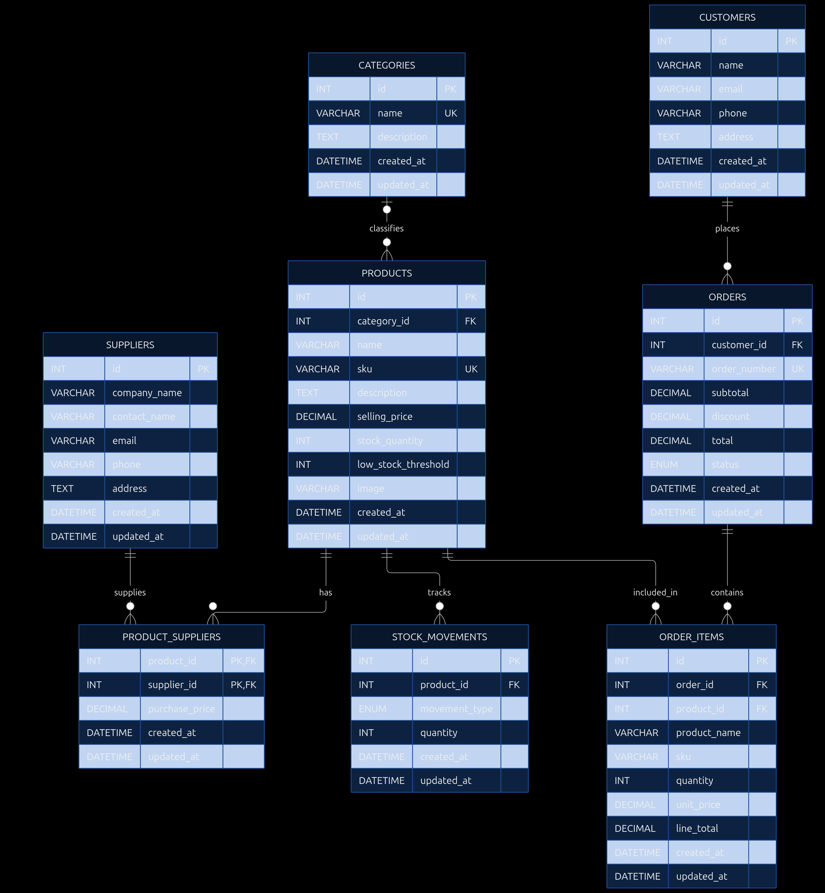

# Phase 01 Final Database Design

**Project:** Stockwise --- Inventory Management System\
**Phase:** 01 --- Requirements Analysis & Database Design\
**Status:** Completed --- ERD baseline approved\
**Database:** MySQL\
**ORM:** Sequelize

------------------------------------------------------------------------

## 1. Phase Objective

The objective of this phase was to translate the Stockwise business
requirements into a relational database design.

The design covers the core entities, their relationships, and the main
business rules that the backend must enforce.

The system is designed for a **single store and a single warehouse**.
Multi-branch and multi-warehouse support are outside the scope of the
first version.

## 2. Scope of the Database

The approved ERD contains eight core tables:

1.  `categories`
2.  `products`
3.  `suppliers`
4.  `product_suppliers`
5.  `customers`
6.  `orders`
7.  `order_items`
8.  `stock_movements`

### 2.1 Table Responsibilities

  -----------------------------------------------------------------------
  Table                               Responsibility
  ----------------------------------- -----------------------------------
  `categories`                        Stores product categories.

  `products`                          Stores product details, selling
                                      price, current stock, low-stock
                                      threshold, and image path.

  `suppliers`                         Stores supplier and contact
                                      information.

  `product_suppliers`                 Connects products to suppliers and
                                      stores the current purchase price
                                      for each product-supplier
                                      relationship.

  `customers`                         Stores registered customer
                                      information.

  `orders`                            Stores order-level information,
                                      totals, and order status.

  `order_items`                       Stores the products included in
                                      each order, including product
                                      snapshots and line totals.

  `stock_movements`                   Records inventory movements and
                                      their quantities.
  -----------------------------------------------------------------------

## 3. Entity Relationships

The database uses the following relationships:

### Categories and Products

-   One category can have many products.
-   Each product belongs to one category.
-   `products.category_id` references `categories.id`.

### Products and Suppliers

-   A product can be supplied by multiple suppliers.
-   A supplier can supply multiple products.
-   This many-to-many relationship is implemented through
    `product_suppliers`.
-   `product_suppliers` stores `product_id`, `supplier_id`, and the
    current `purchase_price` for that relationship.
-   Each product must be associated with at least one supplier.

### Customers and Orders

-   One customer can have many orders.
-   An order may belong to a registered customer.
-   `orders.customer_id` is nullable to support walk-in orders without
    customer details.

### Orders and Order Items

-   One order contains one or more order items.
-   Each order item belongs to one order.
-   Each order item references a product.
-   The same product must appear only once in an order. Adding the same
    product again updates the quantity of its existing order-item row.
-   A unique constraint is required on `(order_id, product_id)`.

### Products and Stock Movements

-   One product can have many stock movement records.
-   Each stock movement belongs to one product.
-   Stock movement records provide an audit history of inventory
    changes.

## 4. Product Rules

-   Every product must belong to a category.
-   Every product must have at least one supplier.
-   SKU must be unique across the system.
-   The system uses EGP only.
-   The first version does not include VAT or other taxes.
-   Products store a selling price, current stock quantity, and
    low-stock threshold.
-   Purchase price is stored in `product_suppliers`, not directly in
    `products`.
-   A product can have different current purchase prices from different
    suppliers.
-   Purchase-price history is not required in the first version.
-   Product images are supported.

## 5. Order Rules

### Order Status

The supported order statuses are:

-   `pending`
-   `completed`
-   `cancelled`

The status rules are:

-   A pending order can be edited, including its products, quantities,
    and discount.
-   A completed order cannot be edited.
-   A cancelled order cannot be reopened. A new order must be created
    instead.

### Order Number

-   Each order has a unique, automatically generated order number.
-   Example format: `ORD-2026-0001`.

### Customer

-   `customer_id` can be `NULL` for walk-in orders.

### Discounts and Totals

-   Discounts can be percentage-based or fixed amounts.
-   A discount cannot exceed the order subtotal.
-   Order totals are calculated by the application according to the
    order items and discount rules.

### Payment

-   Cash is the only supported payment method in the first version.
-   An order must be fully paid before it can become completed.
-   Partial payments and online payments are out of scope.
-   The system does not need a separate payment-transactions table in
    the first version.

### Inventory Effect of Orders

-   Creating a pending order does not reduce stock.
-   Stock is reduced only when an order changes to `completed`.
-   The system must prevent completing an order when there is
    insufficient stock.
-   Stock must never become negative.
-   Cancelling a pending order does not affect stock.
-   Cancelling a completed order restores the sold quantities to stock.
-   Cancelling an order does not record a financial refund in the
    system; the refund is handled outside the application.

### Invoice

-   An invoice PDF is generated when an order is created in pending
    status.
-   The invoice PDF is generated again when the order becomes completed.
-   The invoice number is separate from the order number and is unique
    per order.
-   The same invoice number should be retained when the PDF is
    regenerated at completion.

## 6. Order Item Snapshot

`order_items` stores a snapshot of relevant product information at the
time of the order:

-   `product_name`
-   `sku`
-   `unit_price`
-   `quantity`
-   `line_total`

The line total is calculated as:

`line_total = quantity * unit_price`

The snapshot ensures that historical order details remain available even
if the product's name, SKU, or selling price changes later.

## 7. Inventory and Stock Movements

The current stock quantity is stored in `products.stock_quantity`.

Every inventory change must also be recorded in `stock_movements`.

The agreed movement types are:

-   `IN`
-   `OUT`
-   `SALE`
-   `RETURN`
-   `ADJUSTMENT`

Movement intent:

  Movement Type   Meaning
  --------------- -----------------------------------------------------
  `IN`            Stock received into inventory.
  `OUT`           Stock removed manually from inventory.
  `SALE`          Stock deducted when an order is completed.
  `RETURN`        Stock restored when a completed order is cancelled.
  `ADJUSTMENT`    Manual correction of the recorded stock quantity.

Additional rules:

-   Manual stock adjustments are performed from the Products page.
-   Manual stock changes must always create a stock movement record.
-   Sale and return movements are associated with their relevant order.
-   Manual `IN`, `OUT`, and `ADJUSTMENT` movements are not associated
    with an order.
-   Movement quantity is stored as a positive quantity; the movement
    type determines the business meaning of the movement.

## 8. Transaction and Consistency Rules

When an order is completed or a completed order is cancelled, the
following operations must succeed or fail together in one Sequelize
database transaction:

1.  Update the order status.
2.  Update the affected product stock quantities.
3.  Insert the corresponding stock movement records.

This prevents the order status, current stock, and stock movement
history from becoming inconsistent.

The application must also prevent stock from being deducted more than
once for the same order or restored more than once when that order is
cancelled.

## 9. Database Constraints and Integrity

The database and application must enforce the following rules:

-   Primary keys identify each record.
-   Foreign keys maintain relationships between related tables.
-   `categories.name` is unique.
-   `products.sku` is unique.
-   `orders.order_number` is unique.
-   `order_items` has a unique constraint on `(order_id, product_id)`.
-   Invoice numbers are unique per order.
-   `order_items.line_total` must match `quantity * unit_price`.
-   Product stock must not become negative.
-   A product must have at least one supplier.

Some rules require application-level enforcement and cannot be
guaranteed by a simple foreign key alone. In particular, ensuring that
every product has at least one supplier must be handled by backend logic
when creating or updating product-supplier relationships.

## 10. General System Rules

-   The first version supports one store and one warehouse.
-   Currency is EGP.
-   VAT and taxes are not included.
-   Search and filtering are required on the relevant management pages.
-   The dashboard overview covers the last seven days.

## 11. ERD Reference

The approved ERD diagram for this phase is maintained as the
database-design reference for the project.

**Important:** The ERD image is the visual baseline. Before implementing
Sequelize models, its columns and constraints must be checked against
all the business rules documented above. Any difference must be resolved
in the schema before implementation.

## 12. Phase Deliverables

At the end of Phase 01, the project has:

-   A defined single-store business scope.
-   A documented set of product, supplier, customer, order, payment, and
    inventory rules.
-   An eight-table relational database design.
-   Defined entity relationships and key constraints.
-   Defined inventory and order consistency requirements.
-   A documented baseline for implementing Sequelize models.

## 13. Database ER Diagram

## 14. Next Phase

**Phase 02 --- Project Setup & Configuration**

The next phase prepares the Node.js project, installs the required
dependencies, establishes the MVC folder structure, configures Express
and EJS, sets up environment variables, and prepares the MySQL/Sequelize
connection.

No business logic or Sequelize models are implemented as part of Phase
01.
